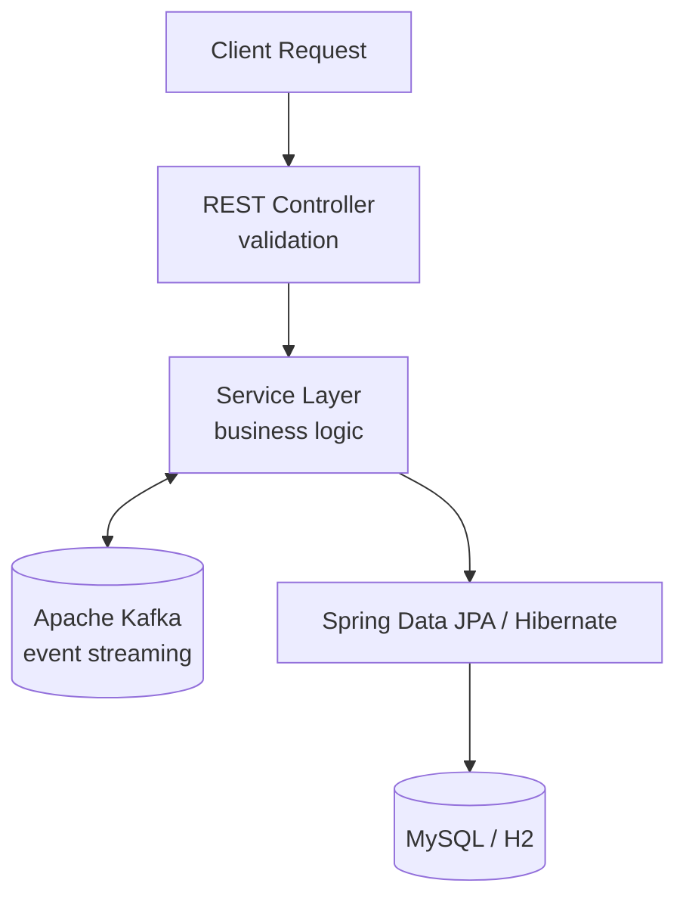

<!-- ======================= HEADER ======================= -->

  
  
  

  
  
  
  

---

## 👨‍💻 About Me

I'm a **Software Engineer** focused on backend development. I build RESTful APIs, event-driven microservices, and relational database systems with **Java, Spring Boot, and Apache Kafka**.

<table>
<tr>
<td align="center" width="25%"><h3>40%+</h3>Faster SQL queries through indexing & schema optimization</td>
<td align="center" width="25%"><h3>500+</h3>Concurrent users supported on a multi-role platform</td>
<td align="center" width="25%"><h3>JPMC</h3>Software Engineering Job Simulation — Kafka microservice</td>
<td align="center" width="25%"><h3>2×</h3>HackerRank certified — SQL (Advanced) & Java</td>
</tr>
</table>

**What I work on**

- 🏗️ **Backend architecture** — clean, layered REST APIs and MVC systems
- ⚡ **Event-driven systems** — Kafka messaging and microservice communication
- 🗄️ **Database design** — 3NF schemas, indexing, and query tuning
- 🔐 **Security & reliability** — RBAC, data integrity, and fault-tolerant API calls
- 🧠 **Fundamentals** — strong grounding in DSA and OOP

---

## 🛠️ Tech Stack

 

| Area | Technologies |
|:--|:--|
| **Languages** | Java, JavaScript, SQL |
| **Frameworks** | Spring Boot, Spring MVC, Spring Data JPA, Hibernate, JDBC |
| **Messaging & Architecture** | Apache Kafka, Microservices, Event-Driven Architecture, REST APIs, System Design |
| **Databases** | MySQL, H2, Aiven MySQL (cloud) — 3NF modeling, indexing, query optimization |
| **Testing & Tools** | JUnit, Postman, IntelliJ IDEA, Git, Maven |
| **Cloud & DevOps** | Docker, Render, AWS, Linux, CI/CD |
| **Practices** | Agile/Scrum, RBAC, Secure Authentication, Version Control |

---

## 🚀 Featured Projects

<table>
<tr>
<td width="50%" valign="top">

### 🏦 [Midas Core](https://github.com/Rahul-web01/midas-core)
**Kafka-based transaction-processing microservice**
 JPMorgan Chase SWE Job Simulation (Forage) · Jul 2026

- Consumes and deserializes high-volume transaction messages from **Kafka**, tested with embedded Kafka
- Validates, persists, and updates balances with **Spring Data JPA** + H2
- Calls an external Incentive REST API via `RestTemplate` and exposes a JSON balance-query endpoint

</td>
<td width="50%" valign="top">

### 📚 [ScholarSpace](https://github.com/Rahul-web01/Scholarspace-main)
**Academic resource management platform**
 Aug 2025

- REST API backend for a multi-role platform (admin, faculty, student) supporting **500+ concurrent users**
- Normalized **MySQL** schema (3NF); **40%+ faster** high-frequency queries via indexing and optimized joins
- Role-based access control (**RBAC**) for tiered permissions

</td>
</tr>
<tr>
<td width="50%" valign="top">

### 👔 [Employee Management System](https://github.com/Rahul-web01/Employee-Management-System)
**Cloud-deployed Spring Boot application**
 Oct 2026

- Containerized with **Docker** (multi-stage build) and deployed to **Render**
- Connected to an **Aiven MySQL** cloud instance over SSL (`sslMode=REQUIRED`)
- Automatic schema initialization with Hibernate and Spring Data JPA for CRUD operations

</td>
<td width="50%" valign="top">

### 💱 [Real-Time Currency Exchange](https://github.com/Rahul-web01/Currency-Exchange-App)
**Multi-currency conversion app**
 Jan 2026

- Integrates third-party exchange-rate APIs for real-time multi-currency conversion
- Fault-tolerant JSON parsing with structured error handling and retry logic

</td>
</tr>
</table>

---

## 📊 GitHub Activity

  

 

<picture>
  <source media="(prefers-color-scheme: dark)" srcset="https://raw.githubusercontent.com/Rahul-web01/Rahul-web01/output/github-contribution-grid-snake-dark.svg" />
  <source media="(prefers-color-scheme: light)" srcset="https://raw.githubusercontent.com/Rahul-web01/Rahul-web01/output/github-contribution-grid-snake.svg" />
  
</picture>

---

## ⚙️ How I Build Backend Services

---

## 📜 Certifications & Achievements

<table>
<tr>
<td width="50%" valign="top">

**🎖️ Certifications**

- SQL (Advanced) — HackerRank
- Java (Basic) — HackerRank
- Software Engineering Job Simulation — JPMorgan Chase (Forage)
- YUVA AI For All — TCS iON × IndiaAI
- AI & Cybersecurity Awareness — MPIT-CoE
- Communication Skills — TCS iON

</td>
<td width="50%" valign="top">

**🏅 Competitions**

- **Zomathon** — Data hackathon by Coding Ninjas × Zomato; data analytics on a real business case
- **NationBuilding Case Study Competition 2026** — Unstop
- **AINCAT 2026** — Naukri Campus

</td>
</tr>
</table>

---

## 🎓 Education

**B.Tech, Computer Science & Engineering** — Babu Banarasi Das University, Lucknow · *2023 – 2027*

---

### 📫 Let's connect

I'm open to **Software Engineering** opportunities. Feel free to reach out.

