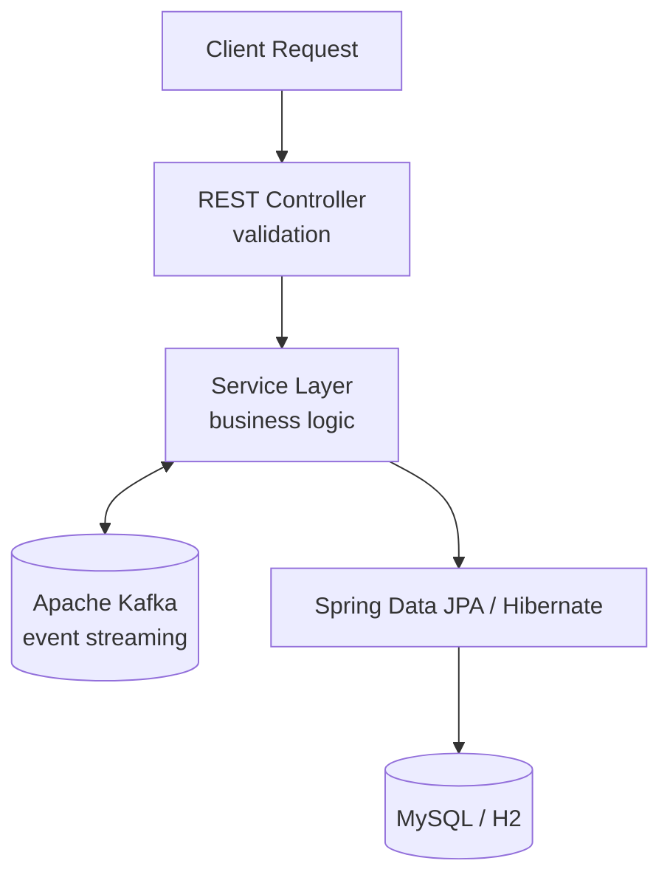

<!-- ======================= HEADER ======================= -->

  
  
  

  
  
  
  

---

## 👨‍💻 About Me

I'm a **Software Engineer** focused on backend development. I build REST APIs, event-driven microservices and full-stack web apps with **Java, Spring Boot and Apache Kafka**, and I ship them live on Render and Vercel.

<table>
<tr>
<td align="center" width="25%"><h3>6</h3>Projects on GitHub, 4 with live demos</td>
<td align="center" width="25%"><h3>800+</h3>Study files searchable inside ScholarSpace</td>
<td align="center" width="25%"><h3>JPMC</h3>Software Engineering Job Simulation — Kafka microservice</td>
<td align="center" width="25%"><h3>2×</h3>HackerRank certified — SQL (Advanced) & Java</td>
</tr>
</table>

**What I work on**

- 🏗️ **Backend architecture** — clean, layered REST APIs and MVC systems
- ⚡ **Event-driven systems** — Kafka messaging and microservice communication
- 🗄️ **Database design** — 3NF schemas, indexing, and query tuning
- 🔐 **Security & reliability** — RBAC, data integrity, and fault-tolerant API calls
- 🧠 **Fundamentals** — strong grounding in DSA and OOP

---

## 🛠️ Tech Stack

 

| Area | Technologies |
|:--|:--|
| **Languages** | Java, JavaScript, TypeScript, Python, SQL |
| **Backend** | Spring Boot, Spring MVC, Spring Security, Spring Data JPA, Hibernate, Thymeleaf |
| **Messaging & Architecture** | Apache Kafka, Microservices, Event-Driven Architecture, REST APIs |
| **Databases & Search** | MySQL, TiDB Cloud, H2, SQLite FTS5 (BM25 full-text search) |
| **Frontend** | React, Vite, Tailwind CSS, Framer Motion |
| **Automation & AI** | Playwright, Ollama (local LLMs) |
| **Testing & Tools** | JUnit 5, Mockito, Postman, IntelliJ IDEA, Git, Maven |
| **Cloud & DevOps** | Docker, Render, Vercel, GitHub Actions, Linux |

---

## 🚀 Featured Projects

<table>
<tr>
<td width="50%" valign="top">

### 🤖 [JobPilot](https://github.com/Rahul-web01/job-pilot)
**Free, private AI job-search assistant**

- Finds jobs from Greenhouse, Lever and Remotive and **scores** each one 0–100 against your skills
- Tailors a resume summary and cover letter per job with a **local LLM (Ollama)**, exported as PDFs
- **Auto-fills** application forms in Chrome with **Playwright**; you review and press Submit

</td>
<td width="50%" valign="top">

### 🏦 [Midas Core](https://github.com/Rahul-web01/midas-core)
**Kafka transaction-processing microservice**
 JPMorgan Chase SWE Job Simulation (Forage) · Jul 2026

- Consumes transactions from a **Kafka** topic and validates sender, recipient and balance
- Updates both balances and records the transaction in one `@Transactional` method with **Spring Data JPA**
- Calls an external incentive REST API with `RestTemplate` and serves balances at `GET /balance`

</td>
</tr>
<tr>
<td width="50%" valign="top">

### 📚 [ScholarSpace](https://github.com/Rahul-web01/Scholarspace-main) · [Live](https://scholarspace-main.vercel.app)
**Free study-material hub with search inside every file**

- **800+ notes and papers across 120+ subjects**, organised by college, course and year
- Full-text search with **SQLite FTS5 + BM25** ranking; scanned pages made searchable with offline OCR
- A nightly **GitHub Actions** job picks up new files and rebuilds the search index

</td>
<td width="50%" valign="top">

### 👔 [Employee Management System](https://github.com/Rahul-web01/Employee-Management-System) · [Live](https://employee-management-system-yuzi.onrender.com)
**Role-based employee portal**
 Oct 2026

- **Spring Security** login with Admin, HR and Viewer roles, BCrypt passwords and CSRF protection
- Employee CRUD with departments, search, validation and friendly error pages
- Tested with JUnit 5, Mockito and MockMvc; **Docker** deploy on Render with a **TiDB Cloud** (MySQL-compatible) database

</td>
</tr>
<tr>
<td width="50%" valign="top">

### 💱 [Currency Converter](https://github.com/Rahul-web01/Currency-Exchange-App) · [Live](https://currency-exchange-app-rahuls-projects-98687e81.vercel.app/)
**Live rates for 160+ currencies**
 Jan 2026

- Rates refresh every minute, with a **30-day trend chart** drawn as a hand-built SVG
- Indian digit grouping and lakh/crore hints for INR
- Runs fully in the browser on free, keyless APIs

</td>
<td width="50%" valign="top">

### 🌐 [Portfolio](https://github.com/Rahul-web01/Rahul-s-Professional-Portfolio) · [Live](https://rahul-s-professional-portfolio.vercel.app/)
**My developer portfolio**

- Projects, skills and experience with scroll animations
- Built with **React 19, TypeScript** and **Tailwind CSS**, deployed on Vercel

</td>
</tr>
</table>

---

## 📊 GitHub Activity

  

 

<picture>
  <source media="(prefers-color-scheme: dark)" srcset="https://raw.githubusercontent.com/Rahul-web01/Rahul-web01/output/github-contribution-grid-snake-dark.svg" />
  <source media="(prefers-color-scheme: light)" srcset="https://raw.githubusercontent.com/Rahul-web01/Rahul-web01/output/github-contribution-grid-snake.svg" />
  
</picture>

---

## ⚙️ How I Build Backend Services

---

## 📜 Certifications & Achievements

<table>
<tr>
<td width="50%" valign="top">

**🎖️ Certifications**

- SQL (Advanced) — HackerRank
- Java (Basic) — HackerRank
- Software Engineering Job Simulation — JPMorgan Chase (Forage)
- YUVA AI For All — TCS iON × IndiaAI
- AI & Cybersecurity Awareness — MPIT-CoE
- Communication Skills — TCS iON

</td>
<td width="50%" valign="top">

**🏅 Competitions**

- **Zomathon** — Data hackathon by Coding Ninjas × Zomato; data analytics on a real business case
- **NationBuilding Case Study Competition 2026** — Unstop
- **AINCAT 2026** — Naukri Campus

</td>
</tr>
</table>

---

## 🎓 Education

**B.Tech, Computer Science & Engineering** — Babu Banarasi Das University, Lucknow · *2023 – 2027*

---

### 📫 Let's connect

I'm open to **Software Engineering** opportunities. Feel free to reach out.

